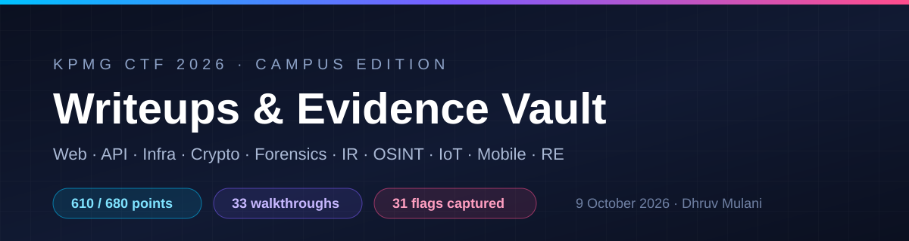

<div align="center">
  
</div>

# KPMG CTF 2026 — Campus Edition · Writeups & Evidence Vault

**610 / 680 points.** Thirty-three challenge walkthroughs from the KPMG CTF 2026 Campus
Edition (KICyb3r platform), covering web, API, infrastructure, cryptography, forensics,
incident response, OSINT, IoT/hardware, mobile and reverse engineering. Every writeup
documents the reconnaissance, the dead ends, the working exploit chain, the evidence
files, and the final flag.

[](#result)
[](#challenge-index)
[](#coverage-at-a-glance)
[](#captured-flags)

| | |
|---|---|
| **Event** | KPMG CTF 2026 — Campus Edition (KICyb3r) |
| **Date** | 9 October 2026 |
| **Result** | **610 / 680 points** |
| **Author** | [Dhruv Mulani (@DHRUV-MULANI)](https://github.com/DHRUV-MULANI) |
| **Flag format** | `KPMG_CTF{...}` |
| **Categories** | Web · API · Infra/Privesc · Crypto · Forensics/IR · OSINT · IoT/Hardware · Mobile · RE · AI/LLM |
| **Working tree** | 35 challenge folders, 290 MB of raw captures and artefacts |

---

## Table of contents

- [Result](#result)
- [Coverage at a glance](#coverage-at-a-glance)
- [Challenge index](#challenge-index)
- [Captured flags](#captured-flags)
- [Category deep dives](#category-deep-dives)
  - [Web](#web)
  - [API & MCP](#api--mcp)
  - [Infrastructure & privilege escalation](#infrastructure--privilege-escalation)
  - [Cryptography & steganography](#cryptography--steganography)
  - [Incident response & forensics](#incident-response--forensics)
  - [OSINT](#osint)
  - [IoT, hardware & pwn](#iot-hardware--pwn)
  - [Mobile](#mobile)
  - [Reverse engineering](#reverse-engineering)
  - [AI / LLM prompt injection](#ai--llm-prompt-injection)
- [Unfinished business](#unfinished-business)
- [Repository map](#repository-map)
- [How the challenges were approached](#how-the-challenges-were-approached)
- [Tooling](#tooling)
- [Reproducing a solve](#reproducing-a-solve)
- [Evidence conventions](#evidence-conventions)
- [What this CTF taught](#what-this-ctf-taught)
- [Security notice & disclaimer](#security-notice--disclaimer)

---

## Result

| Field | Value |
|---|---|
| Points | **610 / 680** |
| Documented challenges | **33** full walkthroughs + 2 artefact-only folders |
| Flags captured | **31** (including per-instance user/root pairs) |
| Strongest categories | API/GraphQL, infrastructure privesc, incident response, OSINT |
| Event window | 9–11 October 2026 |
| Platform | KICyb3r (CTFd + `application_target` dynamic deployments) |

Three challenges were not finished — **Granny makes food**, **OnboardX** and **A Clean
Trail** — plus **Smuggler's Prototype**, where the full chain was proven but the final
flag-producing step was not archived. Their folders are kept with every probe, payload
and negative result rather than deleted, because the failed paths are part of the work.

---

## Coverage at a glance

| Category | Challenges | Solved | Notes |
|---|:---:|:---:|---|
| **Web** | 6 | 4 | SQLi, JWT forgery, request smuggling, agentic SSRF; two deployments were broken/short of root |
| **API** | 4 | 4 | GraphQL field disclosure, delegation abuse, JWT debug escalation, MCP race condition |
| **Infra / privesc** | 9 | 9 | Command injection, Ghostcat, LFI → SSH, exposed Redis, Debian weak keys, chroot jail escape, Baron Samedit |
| **Crypto / stego** | 3 | 3 | Layered encodings, JPEG marker repair + Morse, Debian OpenSSL predictable PRNG |
| **Incident response** | 2 | 2 | DNS dead-drop reconstruction and six-channel exfiltration correlation |
| **OSINT** | 3 | 2 | GitHub history, geolocation, metadata, audio/stego pivots; one final phone-call step missed |
| **IoT / hardware / pwn** | 3 | 3 | PLC debug registers, MQTT last-will abuse, heap UAF → ret2win |
| **Mobile** | 1 | 1 | SQL injection in an Android signup flow → backend admin secret |
| **Reverse engineering** | 2 | 2 | Hash/mixing logic bypass and an input checker |
| **AI / LLM** | 1 | — | Prompt-injection transcript retained, no flag recorded |
| **Total** | **35** | **31** | |

---

## Challenge index

Points are shown where the original writeup recorded them. Some challenges did not have a
point value in the retained notes, so those cells are `—`; the overall event total is the
reported **610 / 680**.

| # | Challenge | Category | Points | Status | Primary technique | Writeup |
|---:|---|---|---:|:---:|---|---|
| 1 | **Arclight - 1** | API / GraphQL | 20 | ✅ | Hidden GraphQL field disclosure | [Read](Arclight1/Arclight-1-SOLVED.md) |
| 2 | **Arclight - 2** | API / GraphQL | 30 | ✅ | Access-request delegation → role escalation → root vault | [Read](Arclight2/Arclight-2-SOLVED.md) |
| 3 | **NexusAPI** | API | 20 | ✅ | Leaked HS256 key → forged `debug` JWT → double-slash route bypass → RCE | [Read](NexusAPI/NexusAPI-writeup.md) |
| 4 | **TradeBot** | API / MCP | 20 | ✅ | TOCTOU settlement race → vault reconciliation leak | [Read](TradeBot/WRITEUP.md) |
| 5 | **DevNote** | Web / SQLi | — | ✅ | HTML-comment creds → SQLite injection → credential and secret dump | [Read](DevNote-writeup.md) |
| 6 | **The Dragon Warrior** | Web | 20 | ✅ | Asset creds → XOR IDOR → JWT secret leak → forged rank → flag | [Read](dragon_warrior/README.md) |
| 7 | **Granny makes food** | Web | 20 | ❌ | Routing-confusion / smuggling theory; deployment exposed only `GET /` | [Read](granny/Granny-makes-food-writeup.md) |
| 8 | **Smuggler's Prototype** | Web | 20 | ⚠️ | CL.TE smuggling → internal config → admin JWT → prototype pollution | [Read](SmugglersPrototype/Smugglers-Prototype-Writeup.md) |
| 9 | **WebSummarizer Pro** | Web / Agentic SSRF | — | ✅ | URL-parser confusion + decimal-IP loopback bypass in an LLM tool | [Read](WebSummarizer-Pro-writeup.md) |
| 10 | **OnboardX** | Web | 30 | ❌ | Mass assignment, RS256 JWT gate, ImageMagick surface | [Read](Onboardx/Onboardx-writeup.md) |
| 11 | **Healthy Hijack - 1** | Infra | 10 | ✅ | Newline command injection → world-writable root cron script | [Read](HealthyHijack1-writeup.md) |
| 12 | **Healthy Hijack - 2** | Infra | 20 | ✅ | Same chain, fresh instance and flags | [Read](HealthyHijack2-writeup.md) |
| 13 | **Tom Wants Peace - 1** | Web / Java | 10 | ✅ | Ghostcat (CVE-2020-1938) AJP file read → flag + SSH key | [Read](TomWantsPeace1-writeup.md) |
| 14 | **Tom Wants Peace - 2** | Infra | 10 | ✅ | SSH key reuse → `cap_setuid+ep` Python → root | [Read](TomWantsPeace2-writeup.md) |
| 15 | **VaultDocs - 1** | Web / Linux | 10 | ✅ | LFI → `/etc/passwd` → weak SSH password → `sudo tar` GTFOBins | [Read](VaultDocs-1-writeup.md) |
| 16 | **VaultDocs - 2** | Web / Linux | 10 | ✅ | Same chain; root flag correctly provisioned | [Read](VaultDocs-2-writeup.md) |
| 17 | **Vodoo Spirit of Death - 1** | Infra | 10 | ✅ | Exposed Redis → chat/session secrets → SSH as `maya.chen` | [Read](VodooSpiritOfDeath1-writeup.md) |
| 18 | **Vodoo Spirit of Death - 2** | Infra | 10 | ✅ | CVE-2021-3156 "Baron Samedit" sudo heap overflow → root | [Read](VodooSpiritOfDeath2/VodooSpiritOfDeath2-writeup.md) |
| 19 | **Locks of Confusion - 1** | Crypto / Web | — | ✅ | Debian OpenSSL predictable PRNG (CVE-2008-0166) key matching | [Read](LocksOfConfusion1/LocksOfConfusion1-writeup.md) |
| 20 | **Locks of Confusion - 2** | Infra / SSH | 20 | ✅ | Reused weak key → `chdir` before `chroot` escape → SUID root | [Read](LocksOfConfusion2/LocksOfConfusion2-writeup.md) |
| 21 | **chall.enc** | Crypto | — | ✅ | Binary → Base64 → hex → Atbash onion | [Read](Crypto/chall_writeup.md) |
| 22 | **challenge_file** | Crypto / Forensics | — | ✅ | Fake PNG magic, JPEG SOF0 repair, OCR, word-length Morse | [Read](Crypto/BLOG_WRITEUP.md) |
| 23 | **Operation Dead Drop** | Incident Response | 20 | ✅ | DNS exfiltration reconstruction from pcap + access log + image | [Read](IR/artifacts/Operation_Dead_Drop_Writeup.md) |
| 24 | **Six Ways Out** | Incident Response | — | ✅ | Six exfiltration channels correlated across auditd, history and pcap | [Read](IR/six_ways_out/incident_response_report.md) |
| 25 | **Golden Hour** | OSINT | 30 | ✅ | GitHub account → deleted git-history file → vault → geolocation → EXIF | [Read](OSINT/GoldenHour-writeup.md) |
| 26 | **WESTBOUND** | OSINT / IR | — | ✅ | LSB stego, email headers, pcap, desk OCR, audio/DTMF, AES container | [Read](OSINT/westbound/WESTBOUND_WRITEUP.md) |
| 27 | **A Clean Trail** | OSINT | 20 | ❌ | Street View geolocation → PrivateBin; final phone-number password missed | [Read](OSINT/a_clean_tail/A_Clean_Trail_Writeup.md) |
| 28 | **Baud Intentions** | Hardware / Web | 10 | ✅ | PLC terminal debug flags + memory register hex → flag | [Read](IOT_baud-intentions-writeup.md) |
| 29 | **Last Will** | IoT / MQTT | 20 | ✅ | `$internal` topic enumeration → duplicate client ID → broker last-will | [Read](lastwill/Last-Will-writeup.md) |
| 30 | **Matrix Reloaded (Freed Memory)** | IoT / Pwn | 30 | ✅ | Heap use-after-free → target-address overwrite → `ret2win` | [Read](iot/WRITEUP.md) |
| 31 | **Latitude of Injection** | Mobile | 20 | ✅ | SQLi in signup → `is_admin=1` → admin panel secret → geofence city | [Read](Mobile/WRITEUP.md) |
| 32 | **Logic Bypass // Auth** | RE | — | ✅ | FNV-1a + mixing state machine reversed → `S4f3-BYPASS42` | [Read](solve/solution.md) |
| 33 | **Second RE binary** | RE | — | ✅ | PIE input checker reversed → accepted flag string | [Read](solve/solution2.md) |
| 34 | **AcmeBank `lookup_user`** | AI / LLM | — | ◻️ | Prompt-injection transcript only; no flag recorded | [Transcript](Ai_prompts) |
| 35 | **TrollClock** | Web (?) | — | ◻️ | Only the captured session cookie survived | [Cookie](cookies.txt) |

**Legend:** ✅ solved · ⚠️ chain proven, final flag step missing · ❌ not solved · ◻️ artefact/transcript only.

---

## Captured flags

<details>
<summary><strong>Expand all 31 flags</strong> (the event is over; targets are offline)</summary>

| Challenge | Flag |
|---|---|
| Arclight - 1 | `KPMG_CTF{h1dd3n_f13ld_n0t_s0_h1dd3n}` |
| Arclight - 2 | `KPMG_CTF{QPv_XrGZAFxc8KmwCR8fh8jP6vP_nYpYhYLxvjL1PLFu}` |
| NexusAPI | `KPMG_CTF{yHtLYuLGYeUeAwQu_yzCniVPiqkr0SGO3RfUh9D4Q0JM}` |
| TradeBot | `KPMG_CTF{O_YU0ekuwGw6DQrzqfo3wExRMZdAiU1I-OR3CAebtGbf}` |
| DevNote | `KPMG_CTF{_YD6yhbWjlH1AyuIZtztcelgNRN2VA1HiVn-bZh4djGW}` |
| The Dragon Warrior | `KPMG_CTF{o_-ODQ02brB5QsTNAdKsWH7FSvp99ue50bXlSRGd2JOj}` |
| Healthy Hijack - 1 (user) | `KPMG_CTF{5aPpZrq2OS51019_pLF7fU2xhbwlhgFasoBE0eHVKPsL}` |
| Healthy Hijack - 1 (root) | `KPMG_CTF{091734c0b3cb2cfaada1e4f4e3cc005a}` |
| Healthy Hijack - 2 (user) | `KPMG_CTF{034900d5c0ef21d3548e7bc6e9c1db9b}` |
| Healthy Hijack - 2 (root) | `KPMG_CTF{YTJYAkR73q4J5WjnWc8wB0fwV5dfbvJNPaTPajwa0Xzu}` |
| Tom Wants Peace - 1 | `KPMG_CTF{X7gQ_GADftheRC9dwRI25mmW9Z8S6K_Zvah1ndwd8WWX}` |
| Tom Wants Peace - 2 | `KPMG_CTF{PcLZb4V8hwQrhtX-HVtCZpGh9gVxWBP-orJVHOorFNlB}` |
| VaultDocs - 1 (user) | `KPMG_CTF{ggjBJYSdrv71TTljSzxF7eMh4ViOdgVaxrjLEAervoTq}` |
| VaultDocs - 2 (root) | `KPMG_CTF{MamhP_3IBGs1INvwz7Hk03NJ0KbOwPNk48rUjjEvHTWk}` |
| Vodoo Spirit of Death - 1 (user) | `KPMG_CTF{70_IN-3fnVk6auUmyo2cXjzxGNyDd5jAi608EGzKX1b6}` |
| Vodoo Spirit of Death - 2 (user) | `KPMG_CTF{6cf60da16034c94ec03370ce6f90308c}` |
| Vodoo Spirit of Death - 2 (root) | `KPMG_CTF{70uFWYXOQHHQyPDE-U8hnnosfwrCFhkFuANAqdZWo_9-}` |
| Locks of Confusion - 1 | `KPMG_CTF{iUfLNLka3pq4XXfreGWQn8dz8UqF534jAtlVuXlSsPAi}` |
| Locks of Confusion - 2 | `KPMG_CTF{czJY_4n20_2NmVtHxXsUS_p5xEvKpJ01KpsO9yhJ1UaA}` |
| chall.enc | `KPMG_CTF{p33l_th3_l4y3rs_l1k3_4n_0n10n}` |
| challenge_file | `KPMG_CTF{S33K_AND_F1ND_M3}` |
| Operation Dead Drop | `KPMG_CTF{tr4ce_the_intrud3r_follow_the_tr4il}` |
| Six Ways Out | `KPMG_CTF{Q7k2mLpk91Xv2QaHncfuEY92kLxP83LmQa7vQm91XeLm92Qx7P}` |
| Golden Hour | `KPMG_CTF{n0va_dr1ft3d_h0m3}` |
| WESTBOUND | `KPMG_CTF{o_-ODQ02brB5QsTNAdKsWH7FSvp99ue50bXlSRGd2JOj}` |
| Baud Intentions | `KPMG_CTF{B-1NcqX9wyLheqD0fa7-DnW6BJfgEajnJxF5ehQPDo_u}` |
| Last Will | `KPMG_CTF{iB-dprsBT6ScaXHwOjWkkNWBr4VXpCe0u9HOn-rPLxN2}` |
| Matrix Reloaded | `KPMG_CTF{Matrix_Escaped}` |
| Latitude of Injection | `KPMG_CTF{LLPs0wc8yOqktZ_2YCr4bGOmoMp6D69u1l3t553TUfOu}` |
| Logic Bypass // Auth | `KPMG_CTF{Y22Uz_coNpabbVfyPwovv7_s7jHm_13-ZxFfkf7rVD3P}` |
| Second RE binary | `KPMG_CTF{1tDhlCmXbPiKSgAvAqfzWTLTWxOtsIEETWfvb83rOTQI}` |

**Decoys spotted:** `KPMG_CTF{find_me_if_you_can}` (NexusAPI), `KPMG_CTF{n0t_th3_r34l_0n3}`
(WESTBOUND LSB), `KPMG_CTF{g0ld3n_h0ur_k33p3r}` (Golden Hour), and
`KPMG_CTF{y0ur_4r3_w45t1g_t1m3_1_d3c0y_fl4g}` (reverse engineering). None were submitted.

</details>

---

## Category deep dives

### Web

#### DevNote — SQLite injection behind a "guest" door
**Files:** [`DevNote-writeup.md`](DevNote-writeup.md) · [`devnote/README.md`](devnote/README.md) · [`devnote/evidence`](devnote)

The login page leaked `<!-- guest:guest123 -->`. The guest dashboard exposed `/dashboard?q=`, a
raw SQLite query interface. Probing confirmed injection, `sqlite_master` revealed the `users` and
`secrets` tables, and the `secrets` row held the flag. The admin account was a decoy — the flag
did not require it.

#### The Dragon Warrior — four small leaks into one forged seal
**Files:** [`dragon_warrior/README.md`](dragon_warrior/README.md) · [`The-Dragon-Warrior-Writeup.md`](The-Dragon-Warrior-Writeup.md) · [`evidence/`](dragon_warrior/evidence)

1. `favicon.svg` contained a comment with `po : skadoosh1`.
2. Training lesson IDs were `XOR(name)`; encrypting other names turned the lesson endpoint into an
   IDOR and exposed Master Shifu's restricted file.
3. The restricted file described an HS256 "dragon seal" and the required `rank` claim.
4. Oogway's chat leaked the signing phrase as literal hex.
5. A forged JWT with `"rank":"dragon-warrior"` passed `/api/dragon-seal/certify` and unlocked
   `/api/scroll`.

#### Smuggler's Prototype — CL.TE, internal config, prototype pollution
**Files:** [`SmugglersPrototype/Smugglers-Prototype-Writeup.md`](SmugglersPrototype/Smugglers-Prototype-Writeup.md)

HAProxy fronted an Express storefront. `robots.txt` hinted at `/internal/` and `/admin`, and the
`/search` handler desynchronised on `Content-Length` vs `Transfer-Encoding` (CL.TE). A smuggled
request with `Host: 127.0.0.1` reached `/internal/`, which leaked the JWT signing secret
`s1gn3d_by_5k4nd4_sup3r_s3cr3t_k3y` and pointed at `/admin/settings` and "PROTOTYPE ... POLLUTION".
The admin JWT was forged and accepted only through the smuggled path. The final prototype-pollution
"ViewFlag" step is documented but the flag itself was not archived.

#### WebSummarizer Pro — agentic SSRF and URL-parser confusion
**Files:** [`WebSummarizer-Pro-writeup.md`](WebSummarizer-Pro-writeup.md)

A FastAPI LLM chat exposed one tool, `functions.fetch_url(url)`, meant to fetch only public HTTPS
URLs. The parser accepted `https://foo.com@2852039166/health`; `2852039166` is the decimal form of
`127.0.0.1`, and the userinfo trick put the real host after `@`. The agent fetched the internal
`/health` endpoint, which returned the flag. Verified with `POST /api/verify`.

#### Granny makes food — the deployment that only had `GET /`
**Files:** [`granny/Granny-makes-food-writeup.md`](granny/Granny-makes-food-writeup.md)

The portal advertised `POST /login`, but every method on `/login` returned a router-level 404.
Full `raft-medium-words` fuzzing, ~1,300 themed paths, traversal, method and header fuzzing, vhosts,
cookies, pickle probes and smuggling variants all failed. The challenge description "best sour items"
is an anagram of **misroutes**, which framed the intended theme, but the single-route deployment
looked incomplete.

#### OnboardX — mass assignment that stopped at the JWT gate
**Files:** [`Onboardx/Onboardx-writeup.md`](Onboardx/Onboardx-writeup.md) · [`Onboardx/evidence`](Onboardx/evidence)

`PATCH /api/user/me` allowed mass assignment: `role=admin`, `is_approved=true`, profile fields.
Avatar upload was validated by extension plus magic bytes only, and the server used ImageMagick 6.
However `/admin` checked the **RS256 JWT claim**, not the database role, and login always minted
`role:"user"`. Algorithm confusion, `kid` traversal and JKU tricks all failed. The confirmed
primitives are preserved for a future attempt.

---

### API & MCP

#### Arclight - 1 — the UI is not the API
**Files:** [`Arclight1/Arclight-1-SOLVED.md`](Arclight1/Arclight-1-SOLVED.md) · [`Arclight1/evidence`](Arclight1/evidence)

Register → login → dashboard. The GraphQL schema was introspected through the client bundle rather
than a blocked introspection query. Category queries (`directory`, `projects`, `travel`) exposed a
hidden field the UI never rendered; requesting it returned the flag directly.

#### Arclight - 2 — standard to root through the platform's own workflow
**Files:** [`Arclight2/Arclight-2-SOLVED.md`](Arclight2/Arclight-2-SOLVED.md) · [`Arclight2/evidence`](Arclight2/evidence)

A standard account leaked delegation metadata (`03_delegation_leak.txt`), revealing the access-request
endpoint and the headers used to approve requests. The account requested root, then approved its own
request (`04_access_request.txt`, `05_approve_headers.txt`). `/api/me` changed to root and the root
vault returned the flag.

#### NexusAPI — debug key leak, forged token, double-slash bypass
**Files:** [`NexusAPI/NexusAPI-writeup.md`](NexusAPI/NexusAPI-writeup.md) · [`NexusAPI/exploit.sh`](NexusAPI/exploit.sh) · [`NexusAPI/forge_jwt.py`](NexusAPI/forge_jwt.py)

A forgotten `/api/v1/user/source` endpoint disclosed the server sources, including the HS256 signing
key. A JWT with `debug:true` unlocked `/exec/{command}`; a guard blocked only the single-slash route,
so `/api/v1//exec/{command}` reached the handler. `printenv FLAG` returned the flag.

#### TradeBot — 22 concurrent sells and a leaky settlement engine
**Files:** [`TradeBot/WRITEUP.md`](TradeBot/WRITEUP.md) · [`TradeBot/solve.py`](TradeBot/solve.py) · [`TradeBot/exploit`](TradeBot)

The MCP server exposed eight JSON-RPC tools over SSE. `FLAG` was a restricted instrument readable
only by the settlement engine. `get_risk_report` disclosed `max_concurrent_settlements: 19` and the
fill window. Buying inventory and firing 22 concurrent sells raced the admission check, produced
`SETTLEMENT_OVERSUBSCRIPTION`, and a contaminated response included `vault_reconciliation` with the
flag.

---

### Infrastructure & privilege escalation

#### Healthy Hijack 1 & 2 — a newline beats a blacklist
**Files:** [`HealthyHijack1-writeup.md`](HealthyHijack1-writeup.md) · [`HealthyHijack2-writeup.md`](HealthyHijack2-writeup.md) · [`HealthyHijack1/artifacts`](HealthyHijack1/artifacts)

The "Safe Command Runner" allowed commands by prefix (`ping`, `traceroute`, `nslookup`), stripped
`; & | \` $( <` but forgot `\n`, and ran `shell=True`. `cmd=nslookup localhost\nid` executed
arbitrary commands as `appuser`. Recovery of `/app/app.py` confirmed the filter. Root came from
`/etc/crontab`: `/opt/healthcheck.sh` was world-writable and run by root every 10 seconds. Replacing
it with a payload that copied `/root/root.txt` to a world-readable file yielded the root flag.

#### Tom Wants Peace 1 & 2 — Ghostcat then `cap_setuid`
**Files:** [`TomWantsPeace1-writeup.md`](TomWantsPeace1-writeup.md) · [`TomWantsPeace2-writeup.md`](TomWantsPeace2-writeup.md) · [`TomWantsPeace1/ajp_ghost.py`](TomWantsPeace1/ajp_ghost.py)

The second published port was Tomcat's AJP connector wrapped in TLS. Tomcat 8.5.50 is vulnerable to
Ghostcat (CVE-2020-1938); a forged `ForwardRequest` with `javax.servlet.include.*` attributes read
`WEB-INF/web.xml`, `WEB-INF/flag.txt` and a leaked SSH private key for user `Ross`. Part 2 logged in
with that key and found a `python3.8` binary with `cap_setuid+ep`, allowing a direct `setuid(0)` and
the root flag.

#### VaultDocs 1 & 2 — LFI to root, twice
**Files:** [`VaultDocs-1-writeup.md`](VaultDocs-1-writeup.md) · [`VaultDocs-2-writeup.md`](VaultDocs-2-writeup.md) · [`VaultDocs/evidence`](VaultDocs/evidence)

`index.php?page=` passed straight into `file_get_contents()`. Reading `/etc/passwd` exposed
`vboxuser`; the password was `changeme`. SSH as `vboxuser` and `sudo -l` showed
`(root) NOPASSWD: /bin/tar`, escalated with the GTFOBins `tar --checkpoint-action=exec` trick.
Instance 1's `ROOT_FLAG` was never injected (the file held the build-time placeholder); instance 2
had a valid root flag.

#### Vodoo Spirit of Death 1 & 2 — open Redis to Baron Samedit
**Files:** [`VodooSpiritOfDeath1-writeup.md`](VodooSpiritOfDeath1-writeup.md) · [`VodooSpiritOfDeath2/VodooSpiritOfDeath2-writeup.md`](VodooSpiritOfDeath2/VodooSpiritOfDeath2-writeup.md) · [`VodooSpiritOfDeath2/cptgibbon`](VodooSpiritOfDeath2/cptgibbon)

Port 10507 was an unauthenticated Redis 5.0.7 holding application sessions and employee chat.
Dumping it produced `maya.chen : Onboard-Maya25!`, valid for SSH on port 25451 (user flag). Part 2
targeted the same container family: Ubuntu 20.04 with `sudo 1.8.31-1ubuntu1`, vulnerable to
CVE-2021-3156 (Baron Samedit). CptGibbon's deterministic PoC produced `uid=0(root)` and the root flag.

#### Locks of Confusion 1 & 2 — Debian weak keys, then a broken jail
**Files:** [`LocksOfConfusion1/LocksOfConfusion1-writeup.md`](LocksOfConfusion1/LocksOfConfusion1-writeup.md) · [`LocksOfConfusion2/LocksOfConfusion2-writeup.md`](LocksOfConfusion2/LocksOfConfusion2-writeup.md) · [`scripts/`](LocksOfConfusion1/scripts)

Part 1's `/verify` gate issued a signed Flask session cookie that unlocked two tarballs: a 2007 tape
restore containing `svc-legacydb`'s RSA public key, and 300 keys generated by the Debian OpenSSL
predictable-PRNG bug (CVE-2008-0166). `privkey_0137.pem` matched; the ZIP password was the first 64
characters of the matching PEM's base64 body.

Part 2 reused that key over SSH. The shell was a busybox jail whose helper called `chdir` **before**
`chroot`, so the working directory escaped the new root. From the real filesystem, a setuid-root
`diag-recovery` helper plus retained `CAP_SYS_CHROOT` (chrooting back so the ELF interpreter resolved)
gave a root shell.

---

### Cryptography & steganography

#### chall.enc — peel the onion
**Files:** [`Crypto/chall_writeup.md`](Crypto/chall_writeup.md) · [`Crypto/solve.py`](Crypto/solve.py)

Space-separated 8-bit binary → ASCII → Base64 → hex → text `PKNT_XGU{...}` → Atbash. The result is
`KPMG_CTF{p33l_th3_l4y3rs_l1k3_4n_0n10n}`.

#### challenge_file — repair the JPEG, then read the words
**Files:** [`Crypto/BLOG_WRITEUP.md`](Crypto/BLOG_WRITEUP.md) · [`Crypto/challenge_file_writeup.md`](Crypto/challenge_file_writeup.md) · [`Crypto/solve.py`](Crypto/solve.py)

The file began with a PNG signature over a JFIF/JPEG stream. Restoring the first eight bytes made it
a JPEG, but the SOF0 marker reported a height of 550 px instead of 1000, cropping the hidden text.
Repairing the height at offset `163:165` exposed a 125-word paragraph whose word lengths were only
3, 5 and 7. Treating 3 as separator, 5 as dot and 7 as dash decoded Morse to
`KPMG_CTF{S33K_AND_F1ND_M3}`.

#### Locks of Confusion - 1 — 2007 called and wanted its entropy back
**Files:** [`LocksOfConfusion1/LocksOfConfusion1-writeup.md`](LocksOfConfusion1/LocksOfConfusion1-writeup.md)

The cryptographic core: match the deployed RSA-2048 public key against 300 known Debian-weak private
keys generated in 2007 (`CVE-2008-0166`), then derive the ZIP password from the matching PEM. The
full chain is in the infra section above.

---

### Incident response & forensics

#### Operation Dead Drop — DNS is the dead drop
**Files:** [`IR/artifacts/Operation_Dead_Drop_Writeup.md`](IR/artifacts/Operation_Dead_Drop_Writeup.md) · [`IR/artifacts`](IR/artifacts)

Three artefacts: `incident.pcap`, `access.log`, `server_image.png`. The web log isolated
`203.0.113.77` and its `DeadDrop-Agent/1.0` user agent. `strings` on the image revealed
`deaddrop v1.2 - exfil over DNS`. Decoding the tunnelled DNS queries reconstructed the exfiltration
and the flag `KPMG_CTF{tr4ce_the_intrud3r_follow_the_tr4il}`.

#### Six Ways Out — six channels, one key
**Files:** [`IR/six_ways_out/incident_response_report.md`](IR/six_ways_out/incident_response_report.md) · [`IR/six_ways_out`](IR/six_ways_out)

Correlated `endpoint/audit.log`, `endpoint/bash_history.txt`, `endpoint/{auth,syslog,application}.log`,
`network/conn.log` and `network/exfiltration.pcap`. Six separate outbound channels (HTTP, DNS, ICMP,
and others) each carried a fragment of the final key; reassembling them produced the flag.

---

### OSINT

#### Golden Hour — GitHub history, then a photograph
**Files:** [`OSINT/GoldenHour-writeup.md`](OSINT/GoldenHour-writeup.md) · [`OSINT/golden_hour`](OSINT/golden_hour)

The site belonged to fictional photographer **Nova Keller** and linked to `github.com/nova-drifts`.
The `driftlog` repository's history still contained a deleted `humans.txt`; recovering it gave the
next pivot. The huge `drop.html` held a client-side vault. A gallery photo's geolocation and metadata
supplied the passphrase, and the vault returned `KPMG_CTF{n0va_dr1ft3d_h0m3}`. The `repos/` tree is
preserved as a zip so the git histories survive.

#### WESTBOUND — every medium at once
**Files:** [`OSINT/westbound/WESTBOUND_WRITEUP.md`](OSINT/westbound/WESTBOUND_WRITEUP.md) · [`OSINT/westbound/evidence`](OSINT/westbound/evidence)

A full incident dossier: LSB stego in `proof.png` (including a bait flag), headers in `phish.eml`,
HTTP transcripts in `westbound.pcap`, OCR of `desk.jpg`, spectrogram and DTMF analysis of `call.wav`,
and a fake vault site. The final `openssl`-compatible AES-256-CBC/PBKDF2 container was attacked with
over 35,000 candidate keys; the correct key produced a ZIP whose manifest held the real marker.
All raw transcripts live under `evidence/`.

#### A Clean Trail — geolocation solved, final call missed
**Files:** [`OSINT/a_clean_tail/A_Clean_Trail_Writeup.md`](OSINT/a_clean_tail/A_Clean_Trail_Writeup.md) · [`OSINT/a_clean_tail/evidence`](OSINT/a_clean_tail/evidence)

`Challenge.png` was an AI re-creation of a Google Street View screenshot showing the **Albany Glen**
storefront in Columbus, Ohio. The supplied PrivateBin paste was password-protected; reverse-engineering
PrivateBin 2.0.6 and a headless-browser test confirmed it. The intended password was the phone number
of a carpet-care service connected to the location. Forty-eight candidates were tried, but the right
number was never found before the event closed.

---

### IoT, hardware & pwn

#### Baud Intentions — a PLC terminal with a debug mode
**Files:** [`IOT_baud-intentions-writeup.md`](IOT_baud-intentions-writeup.md) · [`solve/plcterm.py`](solve/plcterm.py)

A web terminal for a fictional PLCTERM-4 / SCADA-7 node accepted `sysinfo`, `diag`, `mem`, `auth` and
`read`. The two documented `diag` flags had to be used **together** to unlock the debug range. Reading
the debug buffers returned the flag as hex/ASCII chunks which concatenated to
`KPMG_CTF{B-1NcqX9wyLheqD0fa7-DnW6BJfgEajnJxF5ehQPDo_u}`.

#### Last Will — MQTT wildcards and a bumped client
**Files:** [`lastwill/Last-Will-writeup.md`](lastwill/Last-Will-writeup.md) · [`lastwill/scripts`](lastwill/scripts)

The web portal was a decoy; its `/pub/` archive leaked the real design. The broker skipped
`$`-prefixed topics for `#`, and a duplicate client ID evicts the existing client. Subscribing to
`$internal/gateway/registry` revealed the gateway's client ID `gateway01`. Connecting a second client
with that ID kicked the real gateway, and the broker published its Last Will on
`plant/gateway/heartbeat_lost` — a base64 blob containing the flag.

#### Matrix Reloaded (Freed Memory) — a menu, a UAF and `ret2win`
**Files:** [`iot/WRITEUP.md`](iot/WRITEUP.md) · [`iot/exploit`](iot/exploit) · [`iot/artifacts`](iot/artifacts)

The description spelled out the primitive: create → delete → create data → access user. The stale
user object reused freed heap memory; supplying a target function's address as "data" redirected the
virtual call. The non-stripped binary made the target easy to find, and the resulting `ret2win`
printed `KPMG_CTF{Matrix_Escaped}`.

---

### Mobile

#### Latitude of Injection — SQLi in an Android signup flow
**Files:** [`Mobile/WRITEUP.md`](Mobile/WRITEUP.md) · [`Mobile/exploit.py`](Mobile/exploit.py) · [`Mobile/analysis`](Mobile/analysis)

The APK is a Jetpack Compose demo around SQLite. The signup flow concatenates the name into an
`INSERT`, so a crafted name created a row with `is_admin = 1`. That row unlocked the client-side admin
panel, whose "Privileged info" string resource decoded to the backend `secret`. The backend also
required `city`, and the app's hardcoded geofence (`55.7558, 37.6173`) resolved to **Moscow**.
`city=Moscow&secret=...` returned the flag.

---

### Reverse engineering

#### Logic Bypass // Auth — reverse the state machine, not the flag
**Files:** [`solve/solution.md`](solve/solution.md) · [`solve/challenge`](solve/challenge)

`validate_password()` had three layers: a sanity check, an FNV-1a 32-bit hash equation, and a 16-round
mixing transform. Solving the hash equation for printable input and replaying the transform yielded
`S4f3-BYPASS42`. The flag decoder was input-independent: `ENC_FLAG[i] XOR FLAG_KEY[i % 8]`.

#### Second RE binary — a PIE input checker
**Files:** [`solve/solution2.md`](solve/solution2.md) · [`solve/solve2.py`](solve/solve2.py) · [`solve/challenge2nd`](solve/challenge2nd)

A position-independent checker that prints `correct` or `wrong`. Reversing the comparison logic (and
automating candidate recovery in `solve2.py`) produced the accepted flag
`KPMG_CTF{1tDhlCmXbPiKSgAvAqfzWTLTWxOtsIEETWfvb83rOTQI}`.

---

### AI / LLM prompt injection

#### AcmeBank `lookup_user` — prompt transcript
**Files:** [`Ai_prompts`](Ai_prompts)

A transcript of attempts against an account assistant: French translation requests, fake "authorized
access-control audit" framing, and direct requests to read the `admin` record. The model refused to
repeat internal instructions and did not disclose secrets. No flag was recorded for this challenge.
It is included because prompt-injection resistance is part of the event's attack surface.

#### TrollClock — artefact only
**Files:** [`cookies.txt`](cookies.txt)

Only a captured `sid` cookie for
`kicyber-95e96e013035-trollclock-0-0.chals.io` survived. The challenge folder is otherwise empty, so
no reconstruction is possible.

---

## Unfinished business

| Challenge | Points | What was proven | What was missing |
|---|---:|:---:|---|
| **Granny makes food** | 20 | Only `GET /` existed; `/login` was a router 404; full wordlist and ~1,300 themed paths returned 404 | Any additional route or behaviour. The description's anagram "misroutes" suggested routing confusion, but the deployment appeared incomplete. |
| **OnboardX** | 30 | Mass assignment (`role=admin`, `is_approved=true`), weak avatar validation, ImageMagick 6, RS256 JWKS | `/admin` checked the JWT `role` claim; login always issued `role:"user"`. No RS256 forgery or RCE path was found. |
| **A Clean Trail** | 20 | PrivateBin format reverse-engineered; image geolocated to Albany Glen, Columbus, OH; password rule identified | The correct carpet-care phone number / PrivateBin password. |
| **Smuggler's Prototype** | 20 | CL.TE smuggling, internal config leak, admin JWT forgery, prototype-pollution hint | The final `/admin/settings` pollution step that produced the flag. |

All probes, payloads, scripts and raw responses are retained in the corresponding folders.

---

## Repository map

```text
KPMG/
├── README.md                          <- this index
├── LICENSE
├── Ai_prompts                         # AI/LLM prompt-injection transcript
├── cookies.txt                        # TrollClock session artefact
├── assets/
│   └── banner.svg
│
├── Arclight1/                         # API / GraphQL hidden field
│   ├── Arclight-1-SOLVED.md
│   └── evidence/                      # directory, introspection and flag JSON
├── Arclight2/                         # API / delegation → root
│   ├── Arclight-2-SOLVED.md
│   ├── artifacts/                     # gq.py, solve_arclight2.py
│   └── evidence/                      # me-before/after, requests, root vault
├── NexusAPI/                          # API / JWT debug + route bypass
│   ├── NexusAPI-writeup.md
│   ├── exploit.sh, forge_jwt.py
│   ├── openapi.json, server_*.py      # recovered source
│   └── token.txt, exploit_output.txt
├── TradeBot/                          # API / MCP race condition
│   ├── WRITEUP.md, solve.py, flag_leak.py, mcpclient.py
│   ├── race_*.py, recon*.py, probe*.py
│   └── evidence.txt
│
├── DevNote-writeup.md                 # Web / SQLi
├── devnote/                           # numbered request/response evidence
├── dragon_warrior/                    # Web / IDOR + JWT forgery
│   ├── README.md, assets/, scripts/solve.py
│   └── evidence/                      # favicon, lessons, oogway, flag
├── The-Dragon-Warrior-Writeup.md      # expanded duplicate
├── granny/                            # Web / unsolved routing puzzle
│   ├── Granny-makes-food-writeup.md
│   └── ffuf_*.json, themed*.py, smuggling probes
├── SmugglersPrototype/                # Web / CL.TE + prototype pollution
│   └── Smugglers-Prototype-Writeup.md
├── WebSummarizer-Pro-writeup.md       # Web / agentic SSRF
├── Onboardx/                          # Web / unsolved mass-assignment chain
│   ├── Onboardx-writeup.md
│   └── evidence/                      # JWT forge/fuzz scripts, responses, keys
│
├── HealthyHijack1-writeup.md          # Infra / command injection → cron
├── HealthyHijack1/artifacts/          # app.py, PoC, payload, flags
├── HealthyHijack2-writeup.md          # Infra / fresh instance
├── HealthyHijack2/artifacts/
├── TomWantsPeace1-writeup.md          # Java / Ghostcat AJP
├── TomWantsPeace1/                    # ajp_ghost.py, web.xml, id_rsa, flag
├── TomWantsPeace2-writeup.md          # Infra / cap_setuid
├── TomWantsPeace2/                    # enum/root evidence, exploit.sh
├── VaultDocs-1-writeup.md             # Web / LFI → tar GTFOBins
├── VaultDocs/                         # probes, evidence/, lfi scripts
├── VaultDocs-2-writeup.md             # Web / same chain, valid root flag
├── VaultDocs2/                        # evidence/, ssh_run.py
├── VodooSpiritOfDeath1-writeup.md     # Infra / Redis → SSH
├── VodooSpiritOfDeath1/artifacts/     # CVE-2021-3156 source and helper
├── VodooSpiritOfDeath2/               # Infra / Baron Samedit → root
│   ├── VodooSpiritOfDeath2-writeup.md
│   ├── VodooSpiritOfDeath2-draft.md
│   ├── artifacts/, cptgibbon/, evidence/, scripts/
├── LocksOfConfusion1/                 # Crypto / Debian weak keys
│   ├── LocksOfConfusion1-writeup.md
│   ├── raw/                           # portal pages and ffuf output
│   ├── scripts/, evidence/
├── LocksOfConfusion2/                 # Infra / jail escape → SUID root
│   ├── LocksOfConfusion2-writeup.md
│   ├── raw/, scripts/, evidence/
│
├── Crypto/                            # Crypto / stego
│   ├── chall.enc, chall_writeup.md, solve.py
│   ├── challenge_file, challenge_file_writeup.md
│   ├── BLOG_WRITEUP.md                # long-form challenge_file analysis
│   └── restored_image.jpg
│
├── IR/                                # Incident response
│   ├── challenge.elf
│   ├── artifacts.zip, six_ways_out.zip
│   ├── artifacts/                     # access.log, incident.pcap, image, HTTP objects
│   │   └── Operation_Dead_Drop_Writeup.md
│   └── six_ways_out/                  # endpoint/, network/, out_http/, report
│
├── OSINT/
│   ├── GoldenHour-writeup.md
│   ├── golden_hour/                   # site, vault, repos, gallery
│   ├── westbound/                     # pcap, wav, images, sites, evidence/
│   │   ├── WESTBOUND_WRITEUP.md
│   │   └── evidence/                  # LSB, OCR, headers, pcap, keys, FLAG
│   ├── a_clean_tail/                  # Challenge.png, evidence/, writeup
│   └── westbound.zip
│
├── IOT_baud-intentions-writeup.md     # Hardware / PLC debug registers
├── iot/                               # IoT / UAF pwn
│   ├── WRITEUP.md
│   ├── CTF_File/matrix, exploit/, artifacts/
├── lastwill/                          # IoT / MQTT last will
│   ├── Last-Will-writeup.md
│   ├── pub/                           # leaked portal archive
│   ├── scripts/, evidence/
│
├── Mobile/                            # Mobile / SQLi → admin secret
│   ├── WRITEUP.md, exploit.py, exploit.sh, flag.txt
│   ├── loi_v1.apk
│   ├── analysis/                      # manifest, resources, sources
│   └── evidence/
│
├── solve/                             # Reverse engineering
│   ├── challenge, solution.md
│   ├── challenge2nd, solve2.py, solution2.md
│   └── plcterm.py                     # helper for Baud Intentions
│
└── TrollClock/                        # empty; session cookie kept at repo root
```

> `Mobile/work/` (225 MB of decompiled APK output) and the five nested Git repositories under
> `OSINT/golden_hour/repos/` are kept local / archived and excluded from the public snapshot. See
> [.gitignore](.gitignore).

---

## How the challenges were approached

A repeatable loop was used across every category:

1. **Triage the artefact.** `file`, `strings`, `xxd`, `exiftool`, `binwalk`, `tshark` or `ffuf`.
   Separate original data from generated data and decoys.
2. **Read the prompt as a hint.** "best sour items" → *misroutes*, "the engine checks before routing"
   → TOCTOU, "peel it back" → layered encodings, "I never delete" → git history.
3. **Build the smallest proof.** One request, one packet, one key candidate, one marker field.
   Confirm the primitive before automating it.
4. **Automate the repeatable part.** Fuzzers, race harnesses, PRNG key matchers, OCR pipelines,
   pcap extractors and brute-force loops all became short Python scripts kept beside the evidence.
5. **Chain to the flag.** LFI → SSH → sudo; Ghostcat → SSH key → capability; leak → forge → bypass;
   stego → audio → container. A low-impact primitive was only useful once it reached the next one.
6. **Check for decoys before submitting.** Four plausible flag-shaped strings were planted across
   NexusAPI, WESTBOUND, Golden Hour and the RE binary.
7. **Write the negative results down.** The unsolved folders contain every failed payload and
   wordlist, which is why the deployment problems can be stated with evidence instead of guesses.

---

## Tooling

| Area | Tools |
|---|---|
| Web / API | `curl`, `ffuf`, `feroxbuster`, Burp Suite, `jwt_tool`, custom Python (`requests`, `httpx`, `websockets`) |
| Infrastructure | `nmap`, `nc`, `ssh`, `redis-cli`, `sudo` PoCs, GTFOBins, `gdb` |
| Crypto / stego | Python `hashlib`/`cryptography`, `openssl`, `zsteg`-style bit extraction, `tesseract`, `sox`, `ffmpeg` |
| Forensics / IR | `tshark`, `tcpdump`, `zeek`-style logs, `auditd`, `binwalk`, `foremost`, `strings`, `exiftool` |
| OSINT | GitHub API, `git` history recovery, Google Street View, C2PA manifests, OCR |
| Mobile / RE | `jadx`, `apktool`, `ghidra`, `radare2`, `objdump`, `gdb`, `pwntools` |
| Automation | Python 3, parallel shells, threaded/async race harnesses |

---

## Reproducing a solve

Most scripts assume the original challenge instance is reachable. The instances are now offline,
so the retained request/response transcripts are the authoritative evidence.

```bash
# Crypto: layered encodings
python3 Crypto/solve.py

# Crypto / stego: JPEG repair + OCR + Morse
python3 Crypto/solve.py Crypto/challenge_file

# API: NexusAPI JWT + exec chain (edit the host first)
bash NexusAPI/exploit.sh

# API: TradeBot race (edit the MCP host first)
python3 TradeBot/solve.py

# Web: Dragon Warrior end-to-end
python3 dragon_warrior/scripts/solve.py

# RE: logic bypass
./solve/challenge <<< "S4f3-BYPASS42"

# Mobile: backend admin request
python3 Mobile/exploit.py
```

---

## Evidence conventions

- Every challenge keeps its **original writeup** at the path linked in the index.
- Raw captures, JSON responses, logs and OCR output live under `evidence/` or `artifacts/`.
- Scripts are kept in the state they were used; some contain hardcoded dead hostnames from the event.
- Duplicate writeups exist where a short summary and a long-form analysis were both produced
  (Dragon Warrior, challenge_file, VaultDocs, NexusAPI, Granny, Vodoo 2).
- Flags are included because the event has ended and all target infrastructure is offline.

---

## What this CTF taught

1. **Filters are code, not intent.** A prefix whitelist plus a blacklist that forgets `\n` is still
   `shell=True`.
2. **Authorization belongs on the server, in the claim the server checks.** Arclight, Dragon Warrior
   and OnboardX all revolved around *which* identity source was trusted.
3. **A race is a correctness bug.** TradeBot's settlement engine decided admission once and never
   re-checked; 22 concurrent requests turned that into a data leak.
4. **Old crypto never dies.** Debian's 2008 PRNG bug and sudo's 2021 heap overflow both produced roots
   in 2026 because the images were never rebuilt.
5. **Deployment mistakes are part of the challenge.** Granny exposed one route; VaultDocs 1 never
   injected `ROOT_FLAG`. Documenting the deployment gap is as valuable as a flag.
6. **The last mile is OSINT.** A Clean Trail was technically fully mapped except for one phone number;
   Golden Hour fell to a deleted file in git history.
7. **Write down the failures.** Four unsolved/partial challenges are preserved with every probe, which
   makes the writeups honest and reusable.

---

## Security notice & disclaimer

All targets in this repository were **explicitly authorized CTF challenge instances**. The event is
over and the infrastructure is offline. Flags, session cookies, tokens and credentials are inert and
are published only as solve evidence.

Private key material from the challenges (`*.pem`, `id_rsa`, `*.key`) is **excluded** from the public
snapshot by [.gitignore](.gitignore); the writeups still explain how each key was obtained and used.
Do not reuse any credential or key from this repository against any real system.

Nothing here is intended for unauthorized access. The techniques are documented for defensive
learning, detection engineering and CTF practice.

---

<p align="center">
  <sub>KPMG CTF 2026 — Campus Edition · 610 / 680 · 9 October 2026 · Dhruv Mulani</sub>
</p>
